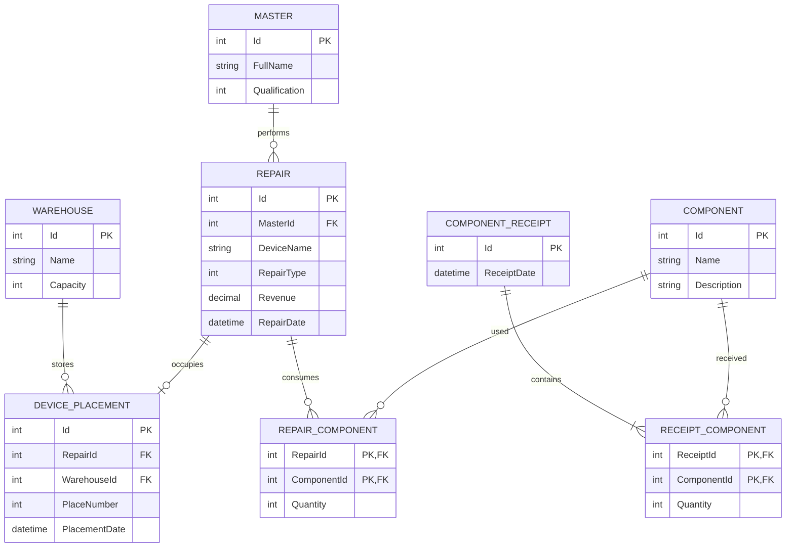

# ER-диаграмма. Вариант 10

Проектируемая схема БД. В ЛР1 подключение БД не выполняется.

Класс ComponentQuantity представляет строку комплектующих внутри ComponentReceipt или Repair.
Идентификатор владельца задается содержащей коллекцией; при подключении БД это две таблицы-связки.
RepairId в DEVICE_PLACEMENT уникален; пара WarehouseId, PlaceNumber также уникальна.
Номер места от 1 до Capacity. Остаток: приход минус расход. Выручка — сумма Revenue
по дате ремонта и мастеру. RepairType — битовая маска нескольких видов работ;
при отчете по отдельным видам сумма за ремонт не должна дублироваться без правила распределения.
